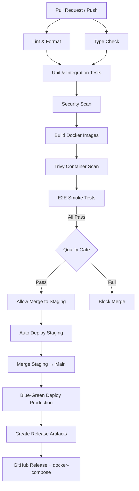

# CI/CD Blueprint - PyForge
## Complete Pipeline Specification for Continuous Integration & Deployment

---

### 3.1 Overview & Principles

#### 3.1.1 Pipeline Philosophy
- **Fail Fast**: Catch issues at earliest stage (lint → type → test → build → security)
- **Quality Gates**: No merge without all gates passing
- **Reproducibility**: Identical results local ↔ CI ↔ production
- **Security First**: SAST, dependency scanning, secret detection on every PR
- **Self-Hosted Friendly**: Artifacts usable for local `docker compose up -d`

#### 3.1.2 Branch Strategy
```
main (protected)
  │
  ├── staging (protected, auto-deploy from main)
  │
  └── feat/* | fix/* | chore/* (short-lived, PR → staging)
        │
        └── PR triggers CI pipeline
```

#### 3.1.3 Environments
| Environment | Branch | Purpose | Auto-Deploy |
|---|---|---|---|
| **Development** | feat/* | PR preview, integration testing | No (manual) |
| **Staging** | staging | Pre-production validation, E2E | Yes (on merge to staging) |
| **Production** | main | Live user traffic | Yes (on merge to main, with approval) |

---

### 3.2 Tahapan CI (Continuous Integration)

**Trigger**: Setiap Pull Request ke `staging` dan Push ke `staging`/`main`

#### 3.2.1 Pipeline Stages (Sequential with Parallel Jobs)

```yaml
# .github/workflows/ci.yml - High-level flow
stages:
  1. lint-and-format          # Fast feedback (~30s)
  2. type-check               # Type safety (~60s)
  3. unit-and-integration-test # Core correctness (~3-5min)
  4. security-scan            # SAST + deps + secrets (~2min)
  5. build-and-scan           # Docker build + Trivy (~5-8min)
  6. e2e-smoke                # Critical path validation (~3min)
```

#### 3.2.2 Stage 1: Linting & Formatting Check (Parallel per Language)

| Target | Tools | Command | Threshold |
|---|---|---|---|
| **Backend (Python)** | ruff, ruff format | `ruff check .` + `ruff format --check .` | 0 errors, 0 warnings |
| **Frontend (TS/React)** | eslint, prettier | `pnpm lint` + `pnpm format:check` | 0 errors, 0 warnings |
| **Dockerfiles** | hadolint | `hadolint Dockerfile*` | 0 errors |
| **YAML/Markdown** | yamllint, markdownlint | `yamllint .` + `markdownlint **/*.md` | 0 errors |

**Job Matrix:**
```yaml
lint:
  strategy:
    matrix:
      include:
        - name: python
          dir: backend
          cmd: ruff check . && ruff format --check .
        - name: frontend
          dir: frontend
          cmd: pnpm lint && pnpm format:check
        - name: docker
          dir: .
          cmd: hadolint Dockerfile* docker/**/Dockerfile*
        - name: configs
          dir: .
          cmd: yamllint .github .gitlab *.yml *.yaml && markdownlint docs/**/*.md
```

#### 3.2.3 Stage 2: Type Checking (Parallel)

| Target | Tool | Command | Config |
|---|---|---|---|
| **Backend** | mypy | `mypy --strict --show-error-codes` | `pyproject.toml` `[tool.mypy]` |
| **Frontend** | TypeScript | `tsc --noEmit --strict` | `tsconfig.json` `"strict": true` |
| **Contracts** | pydantic | Auto via mypy plugins | Pydantic v2 strict mode |

**Fail Criteria:** Any error → pipeline fails. Warnings allowed but tracked.

#### 3.2.4 Stage 3: Automated Testing (Parallel Test Suites)

| Suite | Tool | Command | Coverage Threshold | Timeout |
|---|---|---|---|---|
| **Backend Unit** | pytest | `pytest -xvs --cov=app --cov-fail-under=80 --cov-report=xml` | ≥80% overall, ≥90% new code | 120s |
| **Backend Integration** | pytest | `pytest tests/integration -xvs --cov=app --cov-append` | Included in above | 180s |
| **Sandbox Runner Tests** | pytest | `pytest tests/sandbox -xvs` | N/A (functional) | 300s |
| **AI Provider Mock Tests** | pytest | `pytest tests/ai_providers -xvs` | N/A | 120s |
| **Frontend Unit** | vitest | `pnpm test:run --coverage` | ≥80% | 120s |
| **Frontend Component** | vitest + testing-library | `pnpm test:components` | Included | 120s |

**Special Test Categories:**

##### Sandbox Runner Security Tests (Mandatory Pass)
```python
# tests/sandbox/test_security.py
def test_rejects_os_system():
    """Kode berbahaya os.system harus diblokir"""
    result = run_in_sandbox("import os; os.system('rm -rf /')")
    assert result.status == "blocked"
    assert "forbidden" in result.error.lower()

def test_rejects_infinite_loop():
    """Infinite loop harus timeout"""
    result = run_in_sandbox("while True: pass", timeout=2)
    assert result.status == "timeout"

def test_rejects_network_access():
    """Tidak boleh akses jaringan keluar"""
    result = run_in_sandbox("import requests; requests.get('http://evil.com')")
    assert result.status == "blocked"

def test_rejects_file_write_outside_workdir():
    """Tidak boleh write di luar workspace"""
    result = run_in_sandbox("open('/etc/passwd', 'w').write('hack')")
    assert result.status == "blocked"

def test_resource_limits_enforced():
    """RAM/CPU limits enforced"""
    result = run_in_sandbox("x = 'x' * 10**9", memory_limit_mb=128)
    assert result.status in ("oom", "blocked")
```

##### AI Provider Mock Tests (Mandatory Pass)
```python
# tests/ai_providers/test_mock_providers.py
@pytest.mark.parametrize("provider", ["openai", "9router", "ollama"])
async def test_chat_completion_format(provider):
    """Response format harus kompatibel OpenAI"""
    client = get_mock_client(provider)
    resp = await client.chat.completions.create(
        model="test-model",
        messages=[{"role": "user", "content": "Hello"}]
    )
    assert hasattr(resp, 'choices')
    assert resp.choices[0].message.content is not None

async def test_streaming_response():
    """Streaming harus yield chunks dengan format benar"""
    client = get_mock_client("9router")
    stream = await client.chat.completions.create(
        model="test-model",
        messages=[{"role": "user", "content": "Stream test"}],
        stream=True
    )
    chunks = []
    async for chunk in stream:
        assert hasattr(chunk.choices[0].delta, 'content')
        chunks.append(chunk)
    assert len(chunks) > 1

async def test_rate_limit_429_handling():
    """Harus handle 429 dengan retry/backoff"""
    client = get_mock_client("9router", rate_limit=True)
    with pytest.raises(RateLimitError):
        await client.chat.completions.create(...)
    # Verify retry logic triggered

async def test_timeout_handling():
    """Harus handle timeout dengan graceful error"""
    client = get_mock_client("9router", timeout=True)
    with pytest.raises(TimeoutError):
        await client.chat.completions.create(...)
```

#### 3.2.5 Stage 4: Security & Dependency Scanning (SAST)

| Scan Type | Tool | Command | Severity Threshold |
|---|---|---|---|
| **Python SAST** | bandit | `bandit -r app -f json -o bandit-report.json` | HIGH + MEDIUM = fail |
| **Python Dependencies** | pip-audit | `pip-audit --format=json --output=pip-audit.json` | HIGH + CRITICAL = fail |
| **Node Dependencies** | npm audit | `npm audit --json > npm-audit.json` | HIGH + CRITICAL = fail |
| **Secrets Detection** | gitleaks | `gitleaks detect --source=. --verbose --report-format=json` | ANY leak = fail |
| **Container Scan** | Trivy | `trivy image --severity HIGH,CRITICAL --format json` | HIGH + CRITICAL = fail |
| **License Check** | pip-licenses / npm ls | Custom script | GPL/AGPL = warning, proprietary = fail |

**Security Gate Configuration:**
```yaml
# .github/workflows/security.yml
security-gate:
  needs: [lint, type-check, test]
  runs-on: ubuntu-latest
  steps:
    - uses: actions/checkout@v4
    - name: Run Bandit
      run: bandit -r backend/app -ll -f json -o bandit.json
    - name: Check Bandit Results
      run: |
        HIGH=$(jq '[.results[] | select(.severity=="HIGH")] | length' bandit.json)
        MEDIUM=$(jq '[.results[] | select(.severity=="MEDIUM")] | length' bandit.json)
        if [ "$HIGH" -gt 0 ] || [ "$MEDIUM" -gt 0 ]; then
          echo "::error::Bandit found $HIGH HIGH and $MEDIUM MEDIUM issues"
          exit 1
        fi
    - name: Run pip-audit
      run: pip-audit --desc --format=json --output=pip-audit.json
    - name: Run gitleaks
      uses: gitleaks/gitleaks-action@v2
```

#### 3.2.6 Stage 5: Build & Container Vulnerability Scan

**Build Matrix (Parallel):**
```yaml
build:
  strategy:
    matrix:
      include:
        - name: frontend
          context: ./frontend
          dockerfile: Dockerfile
          tags: ghcr.io/${{ github.repository }}/frontend:${{ github.sha }}
        - name: backend
          context: ./backend
          dockerfile: Dockerfile
          tags: ghcr.io/${{ github.repository }}/backend:${{ github.sha }}
        - name: sandbox-runner
          context: ./sandbox
          dockerfile: Dockerfile.runner
          tags: ghcr.io/${{ github.repository }}/sandbox-runner:${{ github.sha }}
        - name: postgres-migrations
          context: ./backend
          dockerfile: Dockerfile.migrations
          tags: ghcr.io/${{ github.repository }}/migrations:${{ github.sha }}
```

**Trivy Scan (Per Image):**
```yaml
- name: Trivy Scan
  uses: aquasecurity/trivy-action@master
  with:
    image-ref: ${{ matrix.tags }}
    format: 'sarif'
    output: 'trivy-${{ matrix.name }}.sarif'
    severity: 'HIGH,CRITICAL'
    ignore-unfixed: true
    vuln-type: 'os,library'
- name: Upload Trivy Results
  uses: github/codeql-action/upload-sarif@v3
  with:
    sarif_file: 'trivy-${{ matrix.name }}.sarif'
```

**Docker Build Optimization:**
- Multi-stage builds (builder → runner)
- Layer caching with `BUILDKIT_INLINE_CACHE=1`
- `--target runner` for final image
- SBOM generation: `trivy image --format spdx-json`

#### 3.2.7 Stage 6: E2E Smoke Tests (Critical Path Validation)

```yaml
e2e-smoke:
  needs: [build]
  runs-on: ubuntu-latest
  services:
    postgres:
      image: postgres:15-alpine
      env: { POSTGRES_PASSWORD: test }
      ports: [5432:5432]
    redis:
      image: redis:7-alpine
      ports: [6379:6379]
  steps:
    - uses: actions/checkout@v4
    - name: Start Stack
      run: docker compose -f docker-compose.ci.yml up -d
    - name: Wait for Health
      run: |
        timeout 120 bash -c 'until curl -sf http://localhost:8000/health; do sleep 2; done'
    - name: Run Playwright Smoke Tests
      run: |
        cd frontend
        pnpm exec playwright install --with-deps chromium
        pnpm test:e2e:smoke
    - name: Upload Artifacts
      if: failure()
      uses: actions/upload-artifact@v4
      with:
        name: playwright-report
        path: frontend/test-results/
```

**Smoke Test Scenarios (Playwright):**
```typescript
// frontend/tests/e2e/smoke.spec.ts
test.describe('Critical Path Smoke Tests', () => {
  test('Complete daily mission flow', async ({ page }) => {
    await page.goto('/login');
    await page.fill('[name=email]', 'test@pyforge.dev');
    await page.fill('[name=password]', 'testpass123');
    await page.click('button[type=submit]');
    await expect(page).toHaveURL('/dashboard');

    // Open today's mission
    await page.click('[data-testid=today-mission]');
    await expect(page.locator('[data-testid=monaco-editor]')).toBeVisible();

    // Submit solution (simple pass case)
    await page.fill('[data-testid=editor]', 'def solve():\n    return "hello"');
    await page.click('[data-testid=run-tests]');
    await expect(page.locator('[data-testid=test-result]')).toContainText('PASSED');

    // Verify XP/Streak update
    await page.goto('/dashboard');
    await expect(page.locator('[data-testid=xp]')).toContainText('150');
  });

  test('AI Hint flow works', async ({ page }) => {
    // ... test AI hint button triggers request
  });

  test('9Router mock endpoint responds', async ({ page }) => {
    // ... test AI provider integration
  });
});
```

---

### 3.3 Tahapan CD (Continuous Deployment)

#### 3.3.1 Deploy to Staging (Branch: `staging`)

**Trigger**: Merge to `staging` branch (auto from PR merge) or manual dispatch

```yaml
# .github/workflows/cd-staging.yml
name: Deploy Staging
on:
  push:
    branches: [staging]
  workflow_dispatch:

jobs:
  deploy-staging:
    runs-on: ubuntu-latest
    environment: staging
    steps:
      - uses: actions/checkout@v4
      - name: Pull Latest Images
        run: |
          docker compose -f docker-compose.staging.yml pull
      - name: Run Migrations
        run: |
          docker compose -f docker-compose.staging.yml run --rm migrations alembic upgrade head
      - name: Deploy Stack
        run: |
          docker compose -f docker-compose.staging.yml up -d --remove-orphans
      - name: Health Check
        run: |
          timeout 180 bash -c '
            until curl -sf https://staging.pyforge.dev/health; do
              echo "Waiting for health..."; sleep 5;
            done
          '
      - name: Run E2E Smoke Tests
        run: |
          cd frontend && pnpm test:e2e:staging
      - name: Notify Slack
        if: always()
        uses: 8398a7/action-slack@v3
        with:
          status: ${{ job.status }}
          channel: '#deployments'
          fields: repo,commit,author,action,eventName,ref,workflow
```

**Staging Docker Compose Override (`docker-compose.staging.yml`):**
```yaml
version: '3.8'
services:
  frontend:
    image: ghcr.io/org/pyforge/frontend:${{ github.sha }}
    environment:
      - NEXT_PUBLIC_API_URL=https://api-staging.pyforge.dev
      - NEXT_PUBLIC_WS_URL=wss://api-staging.pyforge.dev
    deploy:
      replicas: 2
      resources:
        limits: { cpus: '0.5', memory: '512M' }

  backend:
    image: ghcr.io/org/pyforge/backend:${{ github.sha }}
    environment:
      - DATABASE_URL=postgresql://user:pass@db:5432/pyforge_staging
      - REDIS_URL=redis://redis:6379/0
      - ENVIRONMENT=staging
    deploy:
      replicas: 2
      resources:
        limits: { cpus: '1.0', memory: '1G' }

  sandbox-runner:
    image: ghcr.io/org/pyforge/sandbox-runner:${{ github.sha }}
    deploy:
      replicas: 3
      resources:
        limits: { cpus: '2.0', memory: '2G' }
    # gVisor runtime for isolation
    runtime: runsc
```

#### 3.3.2 Deploy to Production (Branch: `main`)

**Strategy**: Blue-Green Deployment (Zero Downtime)

```yaml
# .github/workflows/cd-production.yml
name: Deploy Production
on:
  push:
    branches: [main]
  workflow_dispatch:
    inputs:
      version:
        description: 'Docker tag to deploy (default: latest SHA)'
        required: false

jobs:
  deploy-production:
    runs-on: ubuntu-latest
    environment: production
    # Manual approval required
    steps:
      - name: Deploy Blue Environment
        run: |
          # Deploy to blue (inactive) environment
          kubectl set image deployment/pyforge-blue \
            frontend=ghcr.io/org/pyforge/frontend:${{ github.sha }} \
            backend=ghcr.io/org/pyforge/backend:${{ github.sha }} \
            -n production
      - name: Health Check Blue
        run: |
          # Wait for blue to be healthy
          kubectl rollout status deployment/pyforge-blue -n production --timeout=300s
          # Run smoke tests against blue
          SMOKE_TARGET=https://blue.pyforge.dev pnpm test:e2e:production
      - name: Switch Traffic to Blue
        run: |
          # Update ingress/service to point to blue
          kubectl patch service pyforge -n production -p '{"spec":{"selector":{"version":"blue"}}}'
      - name: Monitor Green (Previous) for 10min
        run: |
          sleep 600
          # Check error rates, latency
          ERROR_RATE=$(query_prometheus 'rate(http_requests_total{status=~"5.."}[5m])')
          if (( $(echo "$ERROR_RATE > 0.05" | bc -l) )); then
            echo "High error rate, rolling back..."
            kubectl patch service pyforge -n production -p '{"spec":{"selector":{"version":"green"}}}'
            exit 1
          fi
      - name: Decommission Green
        run: |
          kubectl scale deployment/pyforge-green -n production --replicas=0
```

**Health Check & Auto-Rollback Configuration:**
```yaml
# Kubernetes Deployment Spec (production)
apiVersion: apps/v1
kind: Deployment
metadata:
  name: pyforge-backend
spec:
  replicas: 3
  strategy:
    type: RollingUpdate
    rollingUpdate:
      maxSurge: 25%
      maxUnavailable: 0
  template:
    spec:
      containers:
      - name: backend
        image: ghcr.io/org/pyforge/backend:latest
        ports: [{containerPort: 8000}]
        readinessProbe:
          httpGet: {path: /health, port: 8000}
          initialDelaySeconds: 10
          periodSeconds: 5
          failureThreshold: 3
        livenessProbe:
          httpGet: {path: /health, port: 8000}
          initialDelaySeconds: 30
          periodSeconds: 10
        resources:
          requests: {cpu: "500m", memory: "512Mi"}
          limits: {cpu: "2000m", memory: "2Gi"}
---
# PrometheusRule for Auto-Rollback (via Flagger/Argo Rollouts)
apiVersion: flagger.app/v1beta1
kind: Canary
metadata:
  name: pyforge-backend
spec:
  targetRef:
    apiVersion: apps/v1
    kind: Deployment
    name: pyforge-backend
  analysis:
    interval: 30s
    threshold: 3
    metrics:
    - name: request-success-rate
      thresholdRange:
        min: 99
      interval: 30s
    - name: latency-p99
      thresholdRange:
        max: 500
      interval: 30s
    webhooks:
    - name: rollback-on-failure
      type: rollback
      url: http://flagger/rollback
```

#### 3.3.3 Release Artifacts for Self-Hosted Users

**Published Artifacts (Per Release Tag `v*`):**

| Artifact | Description | Usage |
|---|---|---|
| `docker-compose.yml` | Complete stack for `docker compose up -d` | Primary self-hosted install |
| `docker-compose.prod.yml` | Production overrides (SSL, replicas, resources) | Production self-hosted |
| `docker-compose.dev.yml` | Development overrides (hot reload, debug ports) | Local development |
| `.env.example` | All required environment variables | Copy to `.env` and configure |
| `init.sql` | Database initialization script | First-time setup |
| `README-SELFHOSTED.md` | Step-by-step installation guide | User documentation |

**Release Workflow:**
```yaml
# .github/workflows/release.yml
name: Create Release
on:
  push:
    tags: ['v*']

jobs:
  release:
    runs-on: ubuntu-latest
    permissions:
      contents: write
      packages: write
    steps:
      - uses: actions/checkout@v4
        with:
          fetch-depth: 0
      - name: Generate Changelog
        id: changelog
        run: |
          git cliff --tag ${{ github.ref_name }} --output CHANGELOG.md
      - name: Build Release Images
        run: |
          # Build all images with version tag
          docker buildx bake --set "*.tags=ghcr.io/org/pyforge/*:${{ github.ref_name }}" -f docker-bake.hcl
      - name: Push Images
        run: |
          docker push ghcr.io/org/pyforge/frontend:${{ github.ref_name }}
          docker push ghcr.io/org/pyforge/backend:${{ github.ref_name }}
          docker push ghcr.io/org/pyforge/sandbox-runner:${{ github.ref_name }}
      - name: Prepare Release Assets
        run: |
          mkdir -p release-assets
          cp docker-compose.yml docker-compose.prod.yml docker-compose.dev.yml release-assets/
          cp .env.example init.sql README-SELFHOSTED.md release-assets/
          # Update image tags in docker-compose.yml to release version
          sed -i "s|:latest|:${{ github.ref_name }}|g" release-assets/docker-compose*.yml
      - name: Create GitHub Release
        uses: softprops/action-gh-release@v1
        with:
          files: release-assets/*
          body_path: CHANGELOG.md
          draft: false
          prerelease: ${{ contains(github.ref_name, '-rc') }}
```

**Self-Hosted User Quick Start:**
```bash
# User runs:
curl -fsSL https://raw.githubusercontent.com/org/pyforge/v1.0.0/docker-compose.yml -o docker-compose.yml
curl -fsSL https://raw.githubusercontent.com/org/pyforge/v1.0.0/.env.example -o .env
# Edit .env with their 9Router/Ollama config
docker compose up -d
# Access at http://localhost:3000
```

---

### 3.4 Quality Gates Summary (Every PR to Staging)

| Gate | Tool | Threshold | Blocking |
|---|---|---|---|
| **Lint (Python)** | ruff | 0 errors, 0 warnings | ✅ Yes |
| **Lint (Frontend)** | eslint + prettier | 0 errors, 0 warnings | ✅ Yes |
| **Format Check** | ruff format, prettier | 0 diffs | ✅ Yes |
| **Type Check (Python)** | mypy --strict | 0 errors | ✅ Yes |
| **Type Check (TS)** | tsc --noEmit --strict | 0 errors | ✅ Yes |
| **Unit Tests (Py)** | pytest + coverage | All pass, ≥80% cov | ✅ Yes |
| **Unit Tests (TS)** | vitest + coverage | All pass, ≥80% cov | ✅ Yes |
| **Integration Tests** | pytest | All pass | ✅ Yes |
| **Sandbox Security** | Custom pytest | All security tests pass | ✅ Yes |
| **AI Provider Mocks** | Custom pytest | All mock tests pass | ✅ Yes |
| **Bandit SAST** | bandit | 0 HIGH, 0 MEDIUM | ✅ Yes |
| **Dependency Audit** | pip-audit, npm audit | 0 HIGH, 0 CRITICAL | ✅ Yes |
| **Secrets Scan** | gitleaks | 0 leaks | ✅ Yes |
| **Container Scan** | Trivy | 0 HIGH, 0 CRITICAL | ✅ Yes |
| **Docker Build** | docker buildx | Success, multi-arch | ✅ Yes |
| **E2E Smoke** | Playwright | Critical paths pass | ✅ Yes |

---

### 3.5 Pipeline Visualization



---

### 3.6 Local Development CI Simulation

**Pre-commit Hooks (`.pre-commit-config.yaml`):**
```yaml
repos:
  - repo: https://github.com/astral-sh/ruff-pre-commit
    rev: v0.4.0
    hooks:
      - id: ruff-check
        args: [--fix]
      - id: ruff-format
  - repo: https://github.com/pre-commit/mirrors-mypy
    rev: v1.9.0
    hooks:
      - id: mypy
        additional_dependencies: [pydantic, fastapi, sqlalchemy]
  - repo: https://github.com/pre-commit/pre-commit-hooks
    rev: v4.6.0
    hooks:
      - id: check-yaml
      - id: check-json
      - id: end-of-file-fixer
      - id: trailing-whitespace
  - repo: https://github.com/gitleaks/gitleaks
    rev: v8.18.0
    hooks:
      - id: gitleaks
  - repo: local
    hooks:
      - id: pytest-changed
        name: pytest on changed files
        entry: bash -c 'pytest $(git diff --name-only HEAD | grep -E "test_.*\.py$|.*_test\.py$" | head -20)'
        language: system
        pass_filenames: false
```

**Local Full CI Script (`scripts/ci-local.sh`):**
```bash
#!/bin/bash
set -euo pipefail

echo "🔍 Running local CI simulation..."

# 1. Lint & Format
echo "📝 Linting..."
ruff check backend/app && ruff format --check backend/app
cd frontend && pnpm lint && pnpm format:check && cd ..

# 2. Type Check
echo "🔬 Type checking..."
mypy --strict backend/app
cd frontend && pnpm typecheck && cd ..

# 3. Tests
echo "🧪 Running tests..."
pytest backend/tests -xvs --cov=backend/app --cov-fail-under=80
cd frontend && pnpm test:run --coverage && cd ..

# 4. Security
echo "🔒 Security scan..."
bandit -r backend/app -ll
pip-audit --desc
gitleaks detect --source=.

# 5. Docker Build Test
echo "🐳 Testing Docker builds..."
docker buildx bake --load -f docker-bake.hcl

echo "✅ All local CI checks passed!"
```

---

### 3.7 Monitoring & Observability (Post-Deploy)

| Metric | Tool | Alert Threshold |
|---|---|---|
| **API Error Rate** | Prometheus + Grafana | > 1% for 5min |
| **API Latency P99** | Prometheus + Grafana | > 1s for 5min |
| **Sandbox Queue Depth** | Redis + Prometheus | > 100 pending |
| **Sandbox Execution Time** | Histogram | > 10s P95 |
| **AI Request Latency** | Histogram | > 30s P95 |
| **Daily Active Users** | Custom metric | Drop > 20% WoW |
| **Mission Completion Rate** | Custom metric | < 60% |
| **Container Restarts** | K8s / Docker | > 5/hour |
| **Disk Usage** | Node Exporter | > 80% |

**Sentry Integration:**
- Backend: `sentry_sdk.init(dsn=..., traces_sample_rate=0.1)`
- Frontend: `@sentry/nextjs` with replay
- Alert on: New issues, regression, spike in errors

---

### 3.8 Rollback Procedures

| Scenario | Procedure | RTO |
|---|---|---|
| **Failed Staging Deploy** | `docker compose -f docker-compose.staging.yml down && docker compose -f docker-compose.staging.yml up -d` (previous images) | < 5 min |
| **Failed Production Deploy** | `kubectl rollout undo deployment/pyforge-backend -n production` | < 2 min |
| **Database Migration Failed** | `alembic downgrade -1` (via migrations container) | < 10 min |
| **Critical Bug in Production** | Hotfix branch → PR → expedited CI → main → auto-deploy | < 30 min |
| **Security Incident** | Immediate tag rollback + WAF rules + rotate secrets | < 15 min |

---

### 3.9 Compliance & Audit Trail

- **All deployments** logged in GitHub Actions + Argo CD/Flux
- **Image signatures** via cosign (keyless) for supply chain security
- **SBOM** generated per release (SPDX format)
- **Change log** auto-generated via git-cliff (conventional commits)
- **Audit log** for production access (who, when, what)

---

### 3.10 Implementation Checklist

#### Phase 1: Core CI (Week 1)
- [ ] GitHub Actions workflow: `ci.yml` with all 6 stages
- [ ] Pre-commit hooks configured
- [ ] Local CI script (`scripts/ci-local.sh`)
- [ ] Quality gate thresholds defined and enforced
- [ ] Test coverage baseline established

#### Phase 2: Security & Build (Week 2)
- [ ] Bandit, pip-audit, npm audit integrated
- [ ] Gitleaks configured with custom rules
- [ ] Docker multi-stage builds for all services
- [ ] Trivy scanning in pipeline
- [ ] SBOM generation

#### Phase 3: CD Staging (Week 3)
- [ ] `cd-staging.yml` workflow
- [ ] Staging environment provisioned
- [ ] Database migration automation
- [ ] E2E smoke tests in Playwright
- [ ] Slack/Discord notifications

#### Phase 4: CD Production (Week 4)
- [ ] Blue-Green deployment setup (K8s or Docker Swarm)
- [ ] Health checks & auto-rollback configured
- [ ] Production monitoring dashboards
- [ ] Release workflow with artifacts
- [ ] Self-hosted docker-compose publishing

#### Phase 5: Observability (Week 5)
- [ ] Prometheus + Grafana stack
- [ ] Sentry integration
- [ ] Custom business metrics
- [ ] Alert rules & runbooks
- [ ] Load testing baseline

---

*Document Version: 1.0 | Last Updated: 2026-01-17 | Next Review: Sprint Planning*