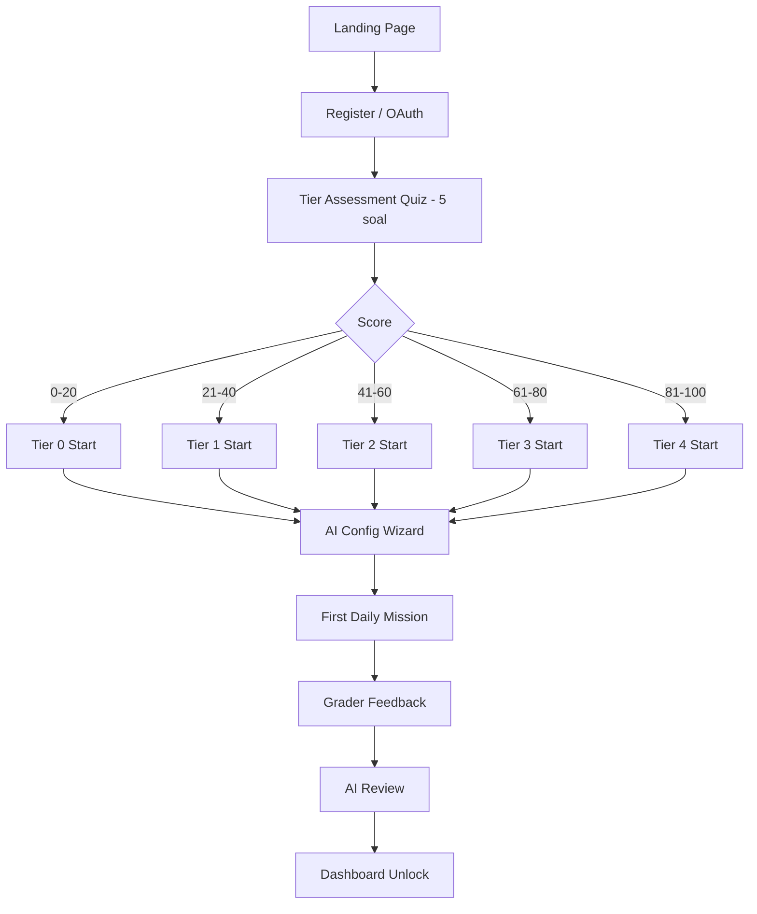
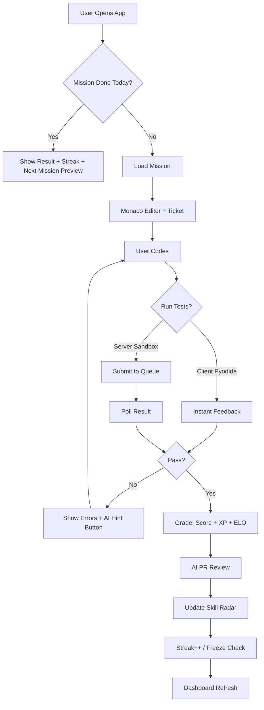

# Product Requirements Document (PRD) - PyForge
## Platform Latihan Python Berbasis Real-Job Simulation

---

### 2.1 Arsitektur & Rekomendasi Tech Stack

#### 2.1.1 High-Level Architecture

```
┌─────────────────────────────────────────────────────────────────────────────┐
│                            PYFORGE ARCHITECTURE                              │
├─────────────────────────────────────────────────────────────────────────────┤
│                                                                              │
│  ┌──────────────┐     ┌──────────────┐     ┌──────────────┐                │
│  │   FRONTEND   │────▶│   BACKEND    │────▶│   DATABASE   │                │
│  │  (Next.js)   │◀───│  (FastAPI)   │◀───│ (PostgreSQL) │                │
│  └──────┬───────┘     └──────┬───────┘     └──────┬───────┘                │
│         │                    │                    │                         │
│         │                    │                    │                         │
│         ▼                    ▼                    ▼                         │
│  ┌──────────────┐     ┌──────────────┐     ┌──────────────┐                │
│  │ MONACO EDITOR│     │  REDIS QUEUE │     │   REDIS      │                │
│  │  (Code Edit) │     │  (Sandbox    │     │  (Cache/     │                │
│  │  Pyodide     │     │   Jobs)      │     │   Rate Limit)│                │
│  └──────────────┘     └──────┬───────┘     └──────────────┘                │
│                              │                                              │
│                              ▼                                              │
│                    ┌──────────────────┐                                    │
│                    │  SANDBOX RUNNER  │                                    │
│                    │  (Docker/gVisor) │                                    │
│                    │  - Python 3.11   │                                    │
│                    │  - pytest/ruff   │                                    │
│                    │  - mypy          │                                    │
│                    └──────────────────┘                                    │
│                              │                                              │
│                              ▼                                              │
│                    ┌──────────────────┐                                    │
│                    │   AI GATEWAY     │                                    │
│                    │  (User Provided) │                                    │
│                    │ 9Router/Ollama/  │                                    │
│                    │ OpenAI-compatible│                                    │
│                    └──────────────────┘                                    │
│                                                                              │
└─────────────────────────────────────────────────────────────────────────────┘
```

#### 2.1.2 Technology Stack Detail

| Layer | Technology | Version | Justification |
|---|---|---|---|
| **Frontend Framework** | Next.js (App Router) | 14.2+ | React Server Components, SEO, performance |
| **Language** | TypeScript | 5.4+ | Type safety, DX, refactoring confidence |
| **Code Editor** | Monaco Editor | 0.48+ | VS Code experience in browser, Python support |
| **Styling** | Tailwind CSS | 3.4+ | Utility-first, dark mode, small bundle |
| **State Management** | Zustand + TanStack Query | Latest | Simple global state, server state caching |
| **Backend Framework** | FastAPI | 0.110+ | Async, auto OpenAPI, Pydantic integration |
| **ORM** | SQLAlchemy 2.0 (async) | 2.0+ | Modern async ORM, type-safe queries |
| **Validation** | Pydantic v2 | 2.7+ | Fast validation, serialization |
| **Database** | PostgreSQL | 15+ | ACID, JSONB, extensions, reliability |
| **Cache/Queue** | Redis | 7.2+ | Rate limiting, job queue, sessions |
| **Auth** | Auth.js (NextAuth v5) | 5.0+ | Multiple providers, edge compatible |
| **Sandbox (Client)** | Pyodide | 0.26+ | WASM Python, runs in browser |
| **Sandbox (Server)** | Docker + gVisor | Latest | Strong isolation, OCI compatible |
| **Container Orchestration** | Docker Compose / K8s | Latest | Local dev + production parity |
| **AI Gateway** | OpenAI-compatible | - | 9Router, Ollama, LM Studio, OpenAI |
| **CI/CD** | GitHub Actions | - | Native GitHub integration |
| **Monitoring** | Sentry + Prometheus/Grafana | - | Error tracking + metrics |

---

### 2.2 Kurikulum: Dari Nol ke Standar Internasional

#### 2.2.1 Career Progression Tracks (Tier System)

| Tier | Nama | Durasi | Fokus Utama | Prasyarat | Jumlah Misi |
|---|---|---|---|---|---|
| **Tier 0** | Survival Basics | Minggu 1-2 | Variabel, tipe data, string, branching, looping, fungsi dasar | None | 14 misi (1/hari) |
| **Tier 1** | Data Wrangling & Algorithmic Thinking | Minggu 3-6 | List/dict comprehension, error handling, JSON/CSV, Big-O, struktur data | Tier 0 complete | 28 misi |
| **Tier 2** | International Engineering Standards | Minggu 7-10 | OOP, Design Patterns, PEP 8, Type Hints (mypy), pytest, venv, logging | Tier 1 complete | 28 misi |
| **Tier 3** | Real-Job Simulation | Minggu 11-16 | REST API (httpx), ETL, asyncio, optimasi query, konkurensi | Tier 2 complete | 42 misi |
| **Tier 4** | Senior-Level Debugging & Refactoring | Berkelanjutan | Legacy refactoring, memory leak, race condition, security, PR review | Tier 3 complete | Ongoing |

#### 2.2.2 Competency Dimensions (Skill Radar)

Setiap user memiliki **Skill Radar** 5 dimensi (skor 0-100):

| Dimensi | Deskripsi | Metrik Pengukuran |
|---|---|---|
| **Logic** | Kemampuan algorithmic thinking, problem decomposition | Test case pass rate, edge case handling |
| **Clean Code** | PEP 8 compliance, naming, structure, DRY, SOLID | ruff score, mypy strictness, cyclomatic complexity |
| **Debugging** | Root cause analysis, logging, reproducible test creation | Bug fix time, test coverage for bugs |
| **Testing** | Unit/integration test design, mocking, edge cases | Test coverage %, mutation testing score |
| **Performance** | Big-O awareness, profiling, optimization | Execution time, memory usage, async efficiency |

#### 2.2.3 ELO Rating System

- **Base Rating**: 1000 (Tier 0 start)
- **K-Factor**: 32 (new), 24 (established), 16 (expert)
- **Matchmaking**: Daily mission difficulty adapts to rating
- **Tier Gates**: Tier 1 unlock at 1100, Tier 2 at 1250, Tier 3 at 1400, Tier 4 at 1600

---

### 2.3 Fitur Inti (Functional Requirements)

#### 2.3.1 A. Mesin Anti-Bosan & Kebiasaan Harian (Daily Engagement Engine)

##### 15-Minute Daily Micro-Missions
Setiap hari 00:00 WIB, sistem generate **3 mode acak** (weighted by tier):

| Mode | Durasi | Deskripsi | Tier Availability |
|---|---|---|---|
| **Fix the Bug** | 5 min | Kode existing dengan 1-2 bug logika/edge case. User fix. | All tiers |
| **Build the Feature** | 10 min | Tulis fungsi/modul baru sesuai spec tiket (AC + sample I/O). | Tier 1+ |
| **Refactor / Code Review** | 5 min | Ubah "kode junior" → kode bersih (PEP 8, type hints, patterns). | Tier 2+ |

**Mission Structure:**
```json
{
  "mission_id": "daily_2026_01_15_001",
  "date": "2026-01-15",
  "mode": "build_feature",
  "tier": 2,
  "title": "Implement Payment Validator",
  "ticket": {
    "id": "TKT-2026-001",
    "type": "Feature",
    "priority": "High",
    "description": "Validasi payload pembayaran sebelum dikirim ke payment gateway",
    "acceptance_criteria": [
      "Amount harus > 0 dan <= 1000000000",
      "Currency harus ISO 4217 (IDR, USD, EUR)",
      "Card number Luhn valid",
      "Expiry date tidak expired"
    ],
    "sample_payload": "{...}"
  },
  "starter_code": "def validate_payment(...):\n    pass",
  "test_file": "tests/test_payment_validator.py",
  "expected_interface": "PaymentValidator.validate(payload: dict) -> ValidationResult",
  "time_limit_minutes": 10,
  "xp_reward": 150,
  "difficulty_rating": 1250
}
```

##### Streak & Freeze Shield
- **Daily Streak**: +1 setiap hari mission completed, reset jika miss (kecuali freeze)
- **Streak Freeze**: 1 item per minggu (claim Sabtu/Minggu), auto-apply jika miss
- **Streak Bonus**: 7-day = 500 XP, 30-day = 5000 XP, 100-day = special badge

##### Boss Fight (Weekly Production Incident)
- **Schedule**: Setiap Jumat 19:00 WIB release, deadline Minggu 23:59
- **Format**: Scenario-based, multi-file, time-boxed (20-30 menit)
- **Example**: "E-commerce flash sale: webhook parser gagal parse JSON corrupt, fix dalam 20 menit"
- **Reward**: 1000 XP + exclusive badge + Streak Freeze item

##### Skill Radar & ELO Rating
- **Update real-time** after each mission submission
- **Visual**: Radar chart (Chart.js/Recharts) di dashboard
- **Leaderboard**: Anonymous, weekly/monthly, opt-in

#### 2.3.2 B. Simulator "Real Job & Real Problem"

##### Workspace Simulasi Kerja (Tier 1+)
```
project-root/
├── ticket.md                 # Jira-style ticket dengan AC
├── app/
│   ├── __init__.py
│   ├── services/
│   │   ├── payment.py        # User edit file ini
│   │   └── notification.py   # Pre-existing, read-only
│   ├── models/
│   │   └── payment.py        # Pydantic models
│   └── utils/
│       └── validators.py     # Helper functions
├── tests/
│   ├── test_payment.py       # Hidden test cases (grader only)
│   └── conftest.py           # Fixtures
├── data/
│   ├── sample_payloads.json  # Test data
│   └── raw_logs.csv          # Real-world messy data
├── requirements.txt          # Dependencies
├── pyproject.toml            # Tool config (ruff, mypy, pytest)
└── README.md                 # Context & setup instructions
```

##### Automated International Grader
**Pipeline Grading (sequential, fail-fast):**

| Stage | Tool | Threshold | Weight | Description |
|---|---|---|---|---|
| **1. Syntax & Lint** | ruff check | 0 errors | 15% | PEP 8, imports, unused vars, complexity |
| **2. Format Check** | ruff format --check | 0 diffs | 10% | Consistent formatting |
| **3. Type Check** | mypy --strict | 0 errors | 20% | Full type safety, no Any |
| **4. Functional Test** | pytest -xvs | 100% pass | 35% | All test cases (visible + hidden) |
| **5. Performance** | Custom benchmark | < threshold | 10% | Time/memory limits per tier |
| **6. Code Quality** | Custom analyzer | Score ≥ 85 | 10% | Cyclomatic complexity, nesting, naming |

**Scoring Formula:**
```
Final Score = Σ(Stage_Score × Weight) 
Grade: S (≥95) | A (≥85) | B (≥75) | C (≥65) | F (<65)
```

**Feedback Output:**
```json
{
  "mission_id": "daily_2026_01_15_001",
  "status": "passed",
  "grade": "A",
  "score": 87.5,
  "stage_results": [
    {"stage": "lint", "passed": true, "details": "0 errors"},
    {"stage": "format", "passed": true, "details": "0 diffs"},
    {"stage": "typecheck", "passed": true, "details": "0 errors"},
    {"stage": "functional", "passed": true, "details": "12/12 passed"},
    {"stage": "performance", "passed": true, "details": "12ms < 50ms limit"},
    {"stage": "quality", "passed": true, "score": 89, "details": "CC: 3, nesting: 2"}
  ],
  "ai_review": "PR Review dari Senior Engineer AI...",
  "xp_earned": 150,
  "elo_change": +12,
  "skill_radar_delta": {"logic": +2, "clean_code": +3, "testing": +1}
}
```

#### 2.3.3 C. Integrasi AI Provider Fleksibel & 9Router Support

##### AI Connection Manager (Settings Page)
```typescript
interface AIProviderConfig {
  id: string;
  name: '9router' | 'ollama' | 'lmstudio' | 'openai' | 'anthropic' | 'custom';
  baseUrl: string;           // e.g., "http://localhost:20128/v1"
  apiKey: string;            // encrypted at rest
  model: string;             // e.g., "kr/claude-sonnet-4.5" or "llama3.1:8b"
  fallbackModels?: string[]; // For 9Router combo
  timeout: number;           // default 30s
  maxRetries: number;        // default 3
  isDefault: boolean;
}
```

##### 9Router Default Configuration
| Parameter | Default Value | Notes |
|---|---|---|
| **Base URL** | `http://127.0.0.1:20128/v1` | IPv4 preferred, avoid IPv6 resolution issues |
| **API Key** | User input dari dashboard 9Router | Stored encrypted |
| **Model/Combo** | User-defined alias atau preset 3-tier fallback | `kr/claude-sonnet-4.5,cc/claude-opus-4-7,kr/gemini-2.5-pro` |
| **Health Check** | `GET /models` + test `POST /chat/completions` | Must return OpenAI-compatible format |

##### AI Roles (Strict Guardrails)

| Role | System Prompt Philosophy | Constraints |
|---|---|---|
| **Socratic Hint Mode** | "Jangan beri jawaban. Tanyakan apa yang user pahami. Beri hint konseptual. ELI5 toggle untuk Tier 0." | **FORBIDDEN**: Full code solutions, direct answers. **REQUIRED**: Questions, analogies, conceptual hints. |
| **Senior Engineer PR Reviewer** | "Review seperti GitHub PR. Kritik naming, sarankan pattern Pythonic, tunjukkan bug potensial dunia nyata. Tone: constructive, mentoring." | **MUST**: Reference specific lines, suggest alternatives, explain WHY. **TONE**: Respectful, educational. |
| **Dynamic Problem Generator** | "Generate ticket + unit test untuk topik spesifik user. Real-world context. Difficulty matched to user tier." | **OUTPUT**: Valid JSON ticket + pytest file. **CONSTRAINT**: Solvable in tier time limit. |

##### AI Usage Tracking & Limits
- **Free tier**: 50 requests/hari (local only), 10/hari (cloud)
- **Pro tier**: Unlimited local, 500/hari cloud
- **Telemetry**: Anonymous usage stats (opt-in), no prompt logging

---

### 2.4 Non-Functional Requirements (NFR)

| ID | Requirement | Metric | Target | Validation Method |
|---|---|---|---|---|
| **NFR-01** | Code Execution Security | Container isolation | `--network=none`, `--read-only`, RAM ≤256MB, CPU ≤1.0, timeout ≤5s | Pen-test, CVE scan |
| **NFR-02** | API Key Privacy | Encryption at rest | AES-256-GCM, never in logs | Code audit, log scanning |
| **NFR-03** | Compilation Feedback Latency | P95 time | < 2 seconds (Pyodide), < 5 seconds (server) | Load test, synthetic monitoring |
| **NFR-04** | Grader Throughput | Concurrent submissions | 100+/minute (server), unlimited (client) | Load test |
| **NFR-05** | Availability | Uptime | 99.9% (cloud), N/A (self-hosted) | SLA monitoring |
| **NFR-06** | Data Portability | Export format | JSON + SQLite dump | GDPR Art. 20 test |
| **NFR-07** | Offline Capability | Tier 0-1 works offline | 100% features | Network disconnect test |
| **NFR-08** | Browser Support | Modern browsers | Chrome 120+, Firefox 121+, Safari 17+, Edge 120+ | BrowserStack test |
| **NFR-09** | Accessibility | WCAG 2.1 AA | Contrast, keyboard nav, screen reader | axe-core audit |
| **NFR-10** | Internationalization | i18n ready | ID (primary), EN (secondary) | Translation coverage >95% |

---

### 2.5 Data Models (Core Entities)

#### 2.5.1 User & Progress
```python
# SQLAlchemy Models (simplified)
class User(Base):
    id: UUID
    email: str (unique)
    username: str (unique)
    password_hash: str
    tier: int (0-4)
    elo_rating: int (default 1000)
    streak_days: int
    longest_streak: int
    freeze_shields: int
    total_xp: int
    skill_radar: Dict[str, int]  # 5 dimensions
    ai_config: Dict[str, AIProviderConfig]  # encrypted
    created_at: DateTime
    last_active: DateTime

class DailyMission(Base):
    id: UUID
    user_id: UUID
    mission_date: Date
    mission_id: str
    mode: Enum[fix_bug, build_feature, refactor]
    tier: int
    status: Enum[not_started, in_progress, submitted, passed, failed]
    started_at: DateTime
    submitted_at: DateTime
    grade: Enum[S, A, B, C, F]
    score: float
    xp_earned: int
    elo_change: int
    code_snapshot: str  # last submitted code
    grader_results: JSONB

class BossFight(Base):
    id: UUID
    week: str  # "2026-W03"
    scenario_id: str
    title: str
    description: str
    files: JSONB  # multi-file structure
    time_limit_minutes: int
    released_at: DateTime
    deadline: DateTime
```

#### 2.5.2 Curriculum Content
```python
class Tier(Base):
    id: int  # 0-4
    name: str
    description: str
    order: int
    unlock_elo: int
    weeks: int

class MissionTemplate(Base):
    id: UUID
    tier: int
    mode: Enum[fix_bug, build_feature, refactor]
    title: str
    ticket_markdown: str  # Jira-style ticket
    starter_code: str
    solution_code: str  # reference implementation
    test_file: str  # pytest content
    expected_interface: str
    time_limit_minutes: int
    xp_reward: int
    difficulty_rating: int  # ELO equivalent
    tags: List[str]  # ["async", "api", "validation"]
    is_boss_fight: bool
```

---

### 2.6 API Contracts (Key Endpoints)

#### 2.6.1 Daily Missions
```
GET    /api/v1/missions/daily           # Get today's mission
POST   /api/v1/missions/daily/submit    # Submit solution
GET    /api/v1/missions/daily/result    # Get grading result
GET    /api/v1/missions/history         # Paginated history
```

#### 2.6.2 Grader (Server-side Sandbox)
```
POST   /api/v1/grader/submit
{
  "mission_id": "uuid",
  "code": "string",
  "language": "python",
  "files": {"path": "content"}  // for multi-file
}

Response:
{
  "job_id": "uuid",
  "status": "pending"
}

GET    /api/v1/grader/result/{job_id}
Response: GraderResult (see 2.3.2)
```

#### 2.6.3 AI Integration
```
POST   /api/v1/ai/hint
{
  "mission_id": "uuid",
  "context": "string",  // user code + error
  "mode": "socratic" | "eli5"
}

POST   /api/v1/ai/review
{
  "mission_id": "uuid",
  "code": "string",
  "grader_results": "GraderResult"
}

POST   /api/v1/ai/generate-problem
{
  "topic": "string",
  "tier": int,
  "difficulty": int
}
```

#### 2.6.4 Settings & AI Config
```
GET    /api/v1/settings/ai-providers
POST   /api/v1/settings/ai-providers
PUT    /api/v1/settings/ai-providers/{id}
POST   /api/v1/settings/ai-providers/{id}/test
DELETE /api/v1/settings/ai-providers/{id}
```

---

### 2.7 User Flows (Critical Paths)

#### 2.7.1 First Time User Onboarding


#### 2.7.2 Daily Mission Loop


---

### 2.8 Acceptance Criteria (Definition of Done)

#### 2.8.1 MVP Launch Criteria
- [ ] **Tier 0 complete**: 14 daily missions, all gradable via Pyodide
- [ ] **Tier 1 complete**: 28 missions, server sandbox functional
- [ ] **Daily Engine**: Mission generation, streak, XP, ELO working
- [ ] **AI Integration**: 9Router + Ollama + OpenAI tested end-to-end
- [ ] **Grader Pipeline**: All 6 stages functional, <5s P95 latency
- [ ] **Self-hosted**: `docker compose up -d` works on clean Ubuntu 22.04
- [ ] **CI/CD**: All quality gates green, auto-deploy to staging
- [ ] **Documentation**: User guide, API docs, architecture, contributing

#### 2.8.2 Quality Gates (Per Feature)
| Gate | Tool | Threshold |
|---|---|---|
| **Lint** | ruff (py), eslint (ts) | 0 errors, 0 warnings |
| **Format** | ruff format, prettier | 0 diffs |
| **Type Check** | mypy --strict, tsc --noEmit | 0 errors |
| **Unit Test** | pytest, vitest | 100% pass, ≥80% coverage new code |
| **Security** | bandit, pip-audit, npm audit, gitleaks | 0 high/critical |
| **Build** | Docker build, Next.js build | Success, image < 500MB |
| **E2E** | Playwright | Critical paths pass |

---

### 2.9 Future Extensibility (Post-MVP)

| Feature | Description | Effort | Priority |
|---|---|---|---|
| **Team Workspaces** | Private org, shared missions, code review | High | P1 |
| **Custom Curriculum Builder** | Drag-drop mission creator for instructors | High | P1 |
| **Hiring Portal** | Company-sponsored challenges, certified profiles | Medium | P2 |
| **Mobile App** | React Native / Expo wrapper | Medium | P2 |
| **Multi-language** | JS/TS, Go, Rust tracks | High | P3 |
| **AI Curriculum Gen** | LLM generates missions from topic | Medium | P3 |
| **Plugin System** | Community sandboxes, graders, AI roles | High | P3 |